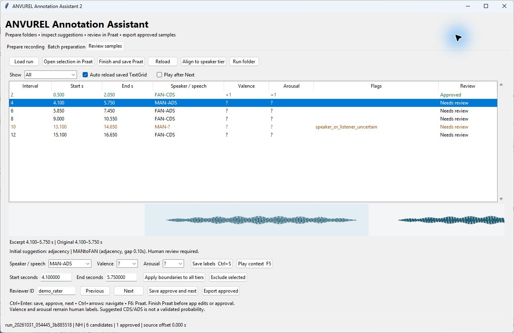

# LENA Acoustic and Interaction Analysis

This repository contains a MATLAB analysis pipeline and the ANVUREL annotation application. Both work with paired LENA ITS and WAV recordings.

| Component | Purpose |
| --- | --- |
| [MATLAB pipeline](#run-the-analysis) | Extract AICM speech segments, classify directed interactions, calculate acoustic features, and merge recording results by subject |
| [ANVUREL](anvurel/README.md) | Prepare draft annotations, review them in Praat, and export approved adult speech clips |

## MATLAB requirements

Use MATLAB R2025b or a compatible release. Each ITS file needs a WAV file with the same filename stem. The pitch analysis uses `shrp.m`, which is included in the repository. Session ID lookup requires `Name_Correspondences.xlsx`.

## Run the analysis

Open MATLAB in the repository folder and run:

```matlab
run_lena_analysis
```

A folder selection window opens. Choose a subject folder, a cohort folder such as `HA` or `CI`, or a common parent folder containing those groups.

You can also pass a path directly. Replace the example below with the location of your recordings:

```matlab
run_lena_analysis(fullfile('data', 'HA'))
```

The earlier entry point remains available:

```matlab
acoust_detail_funcs_newhelpers_MH
```

## Project structure

| File or folder | Responsibility |
| --- | --- |
| `run_lena_analysis.m` | Start the analysis |
| `+lena/config.m` | Define paths, calibration values, and classifier parameters |
| `+lena/find_recordings.m` | Find ITS recordings and read filename metadata |
| `+lena/process_recording.m` | Read ITS data and coordinate analysis for one recording |
| `+lena/classify_interactions.m` | Classify turn pairs and count diagnostic events |
| `+lena/analyze_acoustics.m` | Calculate pitch, level, loudness variability, and syllable measures |
| `+lena/save_results.m` | Export recording results and merge subject workbooks |
| `+lena/create_plots.m` | Create evaluation and comparison plots |
| `legacy/acoust_detail_funcs_original.m` | Preserve the original script for reference |
| `tests/test_lena_pipeline.m` | Run the MATLAB regression checks |
| `anvurel/` | Provide the Windows annotation interface and its Python checks |

## Acoustic measurements

Each analyzed segment can contain these measures:

| Fields | Meaning |
| --- | --- |
| `f0mean`, `f0std`, `f0min`, `f0max`, `f0range` | F0 statistics in Hz |
| `f0rangeST` | F0 range in semitones, calculated as `12 * log2(f0max / f0min)` when both values are positive |
| `dBFS` | Digital level calculated from the segment's RMS amplitude |
| `dBSPL` | Estimated level calculated as `dBFS + cfg.dBSPLCalibrationOffset` |
| `loudnessStd` | Standard deviation of valid frame dBFS values |
| `loudnessRange` | Maximum minus minimum valid frame dBFS |
| `loudnessIQR` | The 75th minus 25th percentile of valid frame dBFS |
| `pctUttVx`, `syllableCount`, `syllablesPerSec` | Voicing and syllable measures |

The default dB SPL calibration offset is 97 dB. Confirm it against the recorder calibration before treating the estimate as calibrated sound pressure. Loudness coefficient of variation is omitted because its interpretation on logarithmic dB values needs further validation.

## Outputs

Results are grouped by analysis date, cohort, subject, and recording:

```text
results_YYYYMMDD/
    cohort/
        subject/
            subject_AICM_INTERACTIONS_All_Recordings.xlsx
            recording/
                *_CHN.mat
                *_CHN2FAN.mat
                *_CHN2MAN.mat
                *_FAN.mat
                *_MAN.mat
                *_AICM_INTERACTIONS.mat
                *_AICM_INTERACTIONS.csv
                *_AICM_INTERACTIONS_All_Segments.csv
                *_EMPTY_SESSION_DIAGNOSTIC.csv
```

Evaluation and comparison plots are also saved for each recording. The first four interaction CSV columns are `file name`, `subject name`, `Session ID`, and `Date`. Dates use `M/d/yyyy` without a time component.

Each subject workbook contains one `All_Segments` sheet combining the exported rows from completed recordings. The workbook is created when that subject's final selected recording finishes. To compare speakers or interaction types, calculate summaries from the segment columns; separate loudness summary sheets are not generated.

When an analysis produces no interactions, `*_EMPTY_SESSION_DIAGNOSTIC.csv` reports conversation and segment counts, rejected neighbors, accepted pairs, output rows, and a reason. The AM28 age vector is used only when the selected folder itself is named `AM28`. Other selections retain `NaN` in the legacy age fields.

## Configuration

Edit [`+lena/config.m`](+lena/config.m) to set the default recording folder or correspondence workbook. The file also holds the algorithm parameters. Those values retain the settings used before the code was reorganized.

To set the estimated dB SPL offset after a calibration review:

```matlab
cfg = lena.config();
cfg.dBSPLCalibrationOffset = 97;
```

To run without plots:

```matlab
cfg = lena.config();
cfg.createPlots = false;
run_lena_analysis(fullfile('data', 'HA'), cfg);
```

## MATLAB checks

Run the regression checks from MATLAB:

```matlab
results = runtests('tests/test_lena_pipeline.m');
assertSuccess(results)
```

The checks cover configuration, recording discovery, interaction classification, acoustic conversions, loudness variability, grouped summaries, date import, empty outputs, and the earlier entry point.

## ANVUREL annotation application

ANVUREL means Assisted Naturalistic Vocal Utterance Review and Emotion Labeling. It prepares adult speech candidates, shows the evidence for CDS or ADS suggestions, and opens selected intervals in Praat. A researcher assigns valence and arousal and approves samples before export.



This screenshot uses generated tones and artificial metadata. The labels demonstrate the interface.

The [application guide](anvurel/README.md) includes installation steps, workflow screenshots, annotation rules, and output descriptions. Install Python 3.12 with Tcl/Tk and the Python launcher, run `setup.cmd` inside `anvurel`, then open `start.cmd`. The guide explains how to obtain and select Praat.

Run the application checks from the repository folder:

```powershell
anvurel\.venv\Scripts\python.exe -m unittest discover -s anvurel -p "test_*.py" -v
```

See the [change history](anvurel/CHANGELOG.md) for version details. Recordings, participant materials, generated outputs, Python environments, and Praat binaries are excluded from the application source package.
