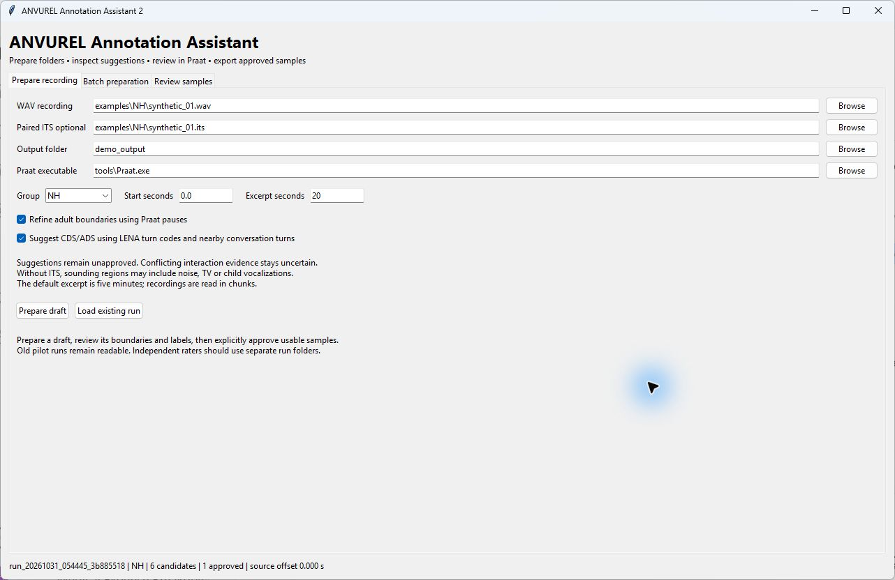
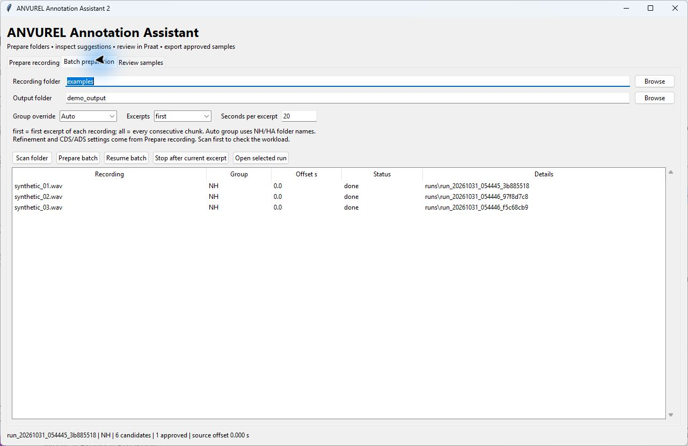
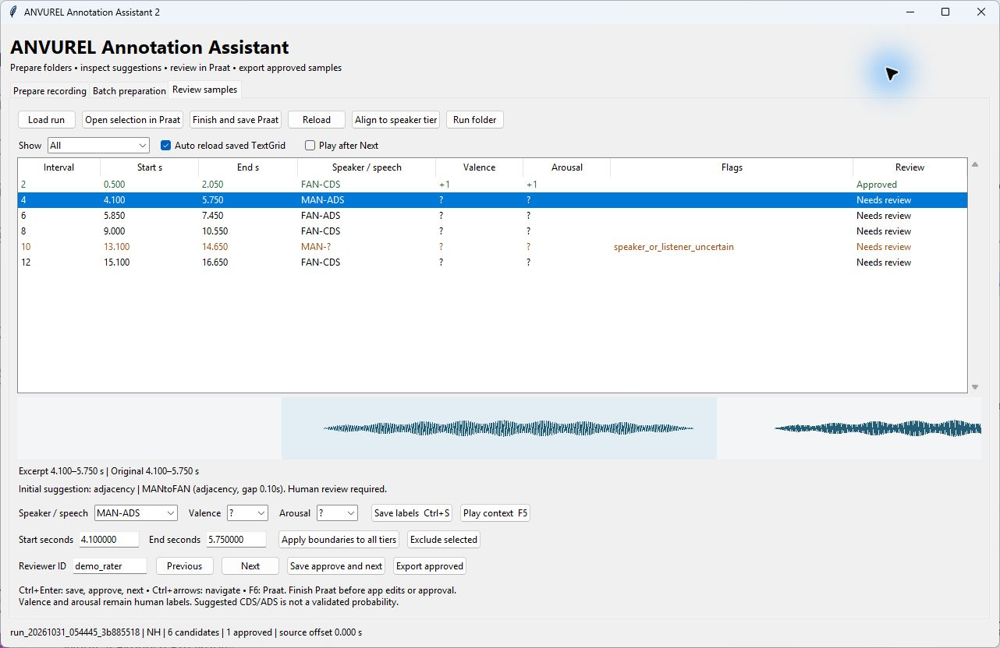
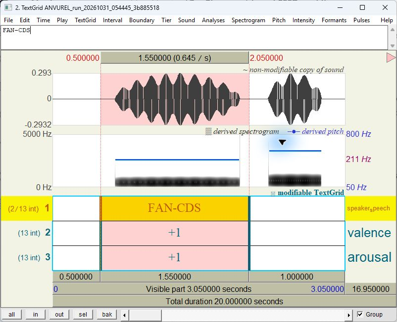

# ANVUREL

Assisted Naturalistic Vocal Utterance Review and Emotion Labeling

Version 2.2.0

ANVUREL is a Windows desktop application for annotating adult speech in LENA recordings. It prepares audio excerpts, imports adult segments from ITS metadata, and creates a Praat TextGrid. A researcher checks the boundaries and labels before exporting clips.

The application can process folders, suggest CDS or ADS labels from conversation metadata, and measure basic acoustic features. Valence and arousal are assigned by the reviewer. Audio processing runs locally.

The screenshots below show generated tones and artificial ITS metadata. Their labels illustrate the controls and have no research interpretation.

## Installation

1. Download the [ANVUREL branch](https://github.com/MAHanafy/LENA-Analysis/archive/refs/heads/anvurel.zip) or clone the repository and select the `anvurel` branch. Extract the archive before running the application.
2. Install Python 3.12 with Tcl/Tk, pip, and the Python launcher. The [Python installation guide for Windows](https://docs.python.org/3.12/using/windows.html) describes these components.
3. Open the `anvurel` folder and run `setup.cmd`. It creates a local `.venv` folder and installs the packages listed in `requirements.txt`. This step needs internet access.
4. Download [Praat for Windows](https://www.fon.hum.uva.nl/praat/download_win.html). Extract `Praat.exe` and either place it in `anvurel/tools` or select its location in the application.
5. Run `start.cmd` from the `anvurel` folder.

The standalone Praat program is used for manual editing. Preparation and acoustic analysis use the Praat engine supplied by Parselmouth. Each computer needs its own Python environment; run `setup.cmd` on that computer rather than copying an existing `.venv` folder.

## Prepare a recording

Start with a short excerpt so you can check its timing and labels before processing a larger collection.



The **Prepare recording** tab specifies the input, output, excerpt duration, and draft annotation options.

1. Choose an uncompressed PCM WAV file. The application fills the ITS field when it finds a file with the same name and an `.its` extension beside the WAV. You can also select the ITS file yourself.
2. Choose a group. **Auto** looks for an exact `NH` or `HA` folder name in the recording's parent path. If neither is present, it uses **Reference**. Check that the selected group matches your study.
3. Enter the start time and excerpt duration in seconds. The default duration is 300 seconds. Excerpts can be up to 3,600 seconds long, and only the selected excerpt is loaded into memory.
4. Keep **Refine adult boundaries using Praat pauses** selected to split imported adult segments at pauses and trim quiet edges. Clear it to retain the ITS segment boundaries.
5. Keep **Suggest CDS/ADS** selected if you want draft labels from the conversation rules. Click **Prepare draft**.

Matching WAV and ITS filenames are required, but do not establish that the files are synchronized. Listen to several intervals and check their timing. The ITS timestamps are interpreted on the original WAV timeline.

You can prepare audio without an ITS file. In that case, sounding regions become candidates and speaker identity remains unknown. Noise, television, and child vocalizations may appear among those regions.

## Prepare a folder



The batch table lists each recording or excerpt, its group, and the preparation status.

1. Open **Batch preparation** and choose the recording folder and output folder.
2. Click **Scan folder**. Review the WAV files, detected groups, missing ITS pairs, and any header errors.
3. Set **Excerpts** to **first** for the first excerpt of each recording, or **all** for consecutive excerpts covering every recording. The default is **first**.
4. Choose the excerpt duration and group override. The refinement and CDS/ADS options are shared with **Prepare recording**.
5. Click **Prepare batch**. A failed recording is reported while other jobs continue.
6. Select a completed row and click **Open selected run** to review it.

Progress is saved after every excerpt in `batch.json` and `batch_report.csv`. **Stop after current excerpt** lets the current job finish. Use **Resume batch** later and select the folder containing `batch.json`; completed jobs are skipped.

If a source file changes, create a new batch. When a completed run is missing, its status becomes `needs_check` so an existing review is not silently replaced. Recursive scanning skips generated outputs, Python environments, and symbolic links.

## Guided review

Prepared runs open in **Guided review**. This screen presents one candidate with large buttons for speaker, listener, valence, and arousal. **Review list** opens the detailed table when you need to inspect several intervals.

**Play interval** plays the selection. You can loop it or choose 0.85 or 0.75 playback speed; slower playback uses Praat duration manipulation to preserve pitch. **Play context** includes one second before and after the selection. Press Escape or click **Stop** to stop playback.

The form is saved automatically as a recovery copy after a short pause in editing. This copy does not change the TextGrid or approve a sample. After reopening a run, choose **Restore saved form** to recover it. A form whose audio or annotations have changed is rejected rather than applied to a different interval.

**Save labels** writes the current labels without approval. **Next** and **Previous** save valid form edits before moving. Apply any boundary edits first. **Approve and next** requires all labels and a reviewer ID.

**Undo last change** restores the previous annotations and approvals from this session. If the form has unsaved edits, its first action resets that form. External changes prevent undo from replacing newer work. **Reset form** discards the recovery copy and reloads saved labels. Earlier annotation files are retained in `history` after the session ends.

## Review the draft



Select an interval in **Review samples**. The waveform shows its boundaries and nearby context. Below it, the application displays the rule behind the initial CDS or ADS suggestion.

Listen, adjust the boundaries if needed, and enter the speaker or speech label, valence, and arousal. Add a reviewer ID before clicking **Save approve and next**. Unknown labels cannot be approved.

The three TextGrid tiers are `speaker_speech`, `valence`, and `arousal`. They share the same interval boundaries.

| Field | Stored values | Meaning |
| --- | --- | --- |
| Speaker or speech | `FAN-CDS`, `FAN-ADS`, `MAN-CDS`, `MAN-ADS` | Adult speaker class and intended listener category |
| Valence | `+1`, `0`, `-1` | Positive, neutral, or negative |
| Arousal | `+1`, `-1` | High or low |
| Unknown | `?`, `FAN-?`, `MAN-?` | Information still requiring review |

Apply your study's coding protocol when assigning these values. FAN and MAN are adult speech classes imported from LENA metadata, rather than individual speaker identities. CDS means child directed speech; ADS means adult directed speech. CHN refers to the key child's vocalizations in the metadata.

Use **Apply boundaries to all tiers** after entering start or end times. Shared neighboring boundaries move together, and the current form labels are saved with the change. **Exclude selected** clears the interval's labels while retaining the audio and a TextGrid backup.

| Control | Action |
| --- | --- |
| **F5** | Play the selected interval with one second of context on each side |
| **Ctrl+S** | Save labels and keep a backup of the previous TextGrid |
| **Ctrl+Enter** | Save, approve under the entered reviewer ID, and select the next candidate |
| **Ctrl+Left** or **Ctrl+Right** | Select the previous or next candidate |
| **F6** | Open the selection in Praat |
| **Show** | Filter the list by review status or place flagged intervals first |
| **Play after Next** | Play context when moving to another candidate |

An approval applies to the exact boundaries and labels that were reviewed. Changing them invalidates that approval. External file changes leave unsaved form edits in place; choosing **Reload** discards those edits. Earlier TextGrids are kept in the run's `history` folder.

## Edit in Praat



Praat opens with the selected interval and the three annotation tiers. The example above uses generated audio.

1. Save your work in any other Praat instance and close that instance before starting a review from ANVUREL.
2. Select a candidate and click **Open selection in Praat**, or press **F6**.
3. Correct the boundaries and labels in the editor. ANVUREL pauses its own editing, approval, and export controls while that session is open. Its Previous and Next controls can still navigate the Praat editor.
4. Return to ANVUREL and click **Finish and save Praat**. This saves the TextGrid, closes the dedicated session, and reloads the annotations.

You may also save and close Praat manually. Save the Praat session before closing ANVUREL. **Auto reload saved TextGrid** detects external saves. If the tier boundaries differ, **Align to speaker tier** rebuilds the valence and arousal intervals from the speaker tier. It retains unambiguous labels, replaces conflicting labels with `?`, and keeps a backup.

In Praat, Shift plus drag moves boundaries that share a time across tiers. The application communicates with Praat through scripts and `--send` commands. This requires a Windows desktop session that permits communication between processes. Automated navigation and saving require a single Praat instance.

## Timed transcripts

The **Transcript** tab imports JSON from Whisper, SRT, or VTT. Choose whether the times refer to the excerpt or the original recording before importing. Original times are converted using the excerpt's source offset. Cues crossing an excerpt boundary are clipped and flagged for checking.

Select a text segment and click **Play text segment** to hear that exact span. **Show matching annotation** selects the candidate with the greatest overlap. Text overlapping the current candidate also appears in Guided review. A cue that covers several intervals can appear for each of them; it does not establish a word boundary.

For local speech recognition, run `setup_transcription.cmd` once to install the optional speech component. Choose `tiny`, `base`, or `small`, then click **Generate transcript**. The first use needs **Allow model download** selected to obtain the model. Leave it cleared to use only models already cached on the computer. Audio processing runs locally. The language field accepts `auto` or a language code such as `en`.

Generation runs in the background and can be stopped after the current model or decoding step. An incomplete or failed operation retains the previous transcript. Saved text is tied to the excerpt checksum and source offset. Changed audio or invalid times require a new transcript.

Transcript text remains a draft. Listen to confirm its words and timing. Import and generation leave the speaker, emotion, and approval labels unchanged.

## How suggestions are made

The rules use adult segments, child utterance times, conversation boundaries, word counts, and turn codes from the ITS file. Within a conversation, they look for a preceding valid turn that ends no more than five seconds before the current turn. Recognized LENA turn codes take precedence over the timing fallback.

An adult and child pair can support CDS. A pair from different adult classes can support ADS. If the evidence conflicts or is missing, the label stays unknown. Two FAN turns, or two MAN turns, do not establish that different people are speaking. Overlapping adult segments also retain unknown labels and an overlap flag.

The rules adapt the repository's [`classify_interactions.m`](https://github.com/MAHanafy/LENA-Analysis/blob/anvurel/%2Blena/classify_interactions.m). ANVUREL considers all conversation types; the MATLAB extraction workflow uses AICM conversations. For comparisons, the Python function `interaction_suggestions(..., aicm_only=True)` can restrict suggestions to that scope.

These suggestions are rules requiring review, with no calibrated confidence score. The evidence is saved in `suggestions.json`. The application includes no trained model for valence or arousal.

## Segmentation and acoustic measurements

Pause refinement uses Praat's [silent and sounding interval analysis](https://www.fon.hum.uva.nl/praat/manual/Sound__To_TextGrid__silences____.html). It does not determine whether a sound is speech. Silent or unsuitable adult segments are retained with a flag for review.

| Setting | Current value |
| --- | --- |
| Silence threshold | 25 dB below the local maximum |
| Minimum silence | 250 ms |
| Minimum sounding interval | 120 ms |
| Boundary padding | 30 ms, constrained to the original segment |
| Adult pitch search range | 60 to 600 Hz |

Measurements include interval duration, RMS level in dBFS, mean and range of voiced F0, and voiced fraction. Review the analysis settings for your population. dBFS measures digital signal level and is not calibrated sound pressure. Parselmouth's embedded Praat engine may differ from the standalone program.

Speech rate and learned emotion predictions are not included. Time savings and annotation agreement still need to be evaluated against independent human annotations.

## Saved files and exports

By default, runs are saved under `outputs/anvurel/automation_runs` in the repository folder. You can choose another output location in the interface.

| File in each run | Contents |
| --- | --- |
| `excerpt.wav` | Audio for the selected excerpt |
| `annotations.TextGrid` | The three annotation tiers |
| `run.json` | Source details, excerpt timing, preparation settings, and audio checksum |
| `suggestions.json` | Initial labels, supporting rules, and overlap flags |
| `quality.csv` | Preparation flags for quiet audio, possible clipping, short intervals, and uncertain speaker or listener |
| `acoustics.csv` | Acoustic measurements at the preparation boundaries |
| `reviews.json` | Explicit approvals and reviewer IDs |
| `activity.jsonl` | Preparation and review events |

Click **Export approved** after reviewing the intervals you want to use. Each export is written to a new folder. It contains the approved clips, reviewed TextGrid and excerpt, timestamps on the original and excerpt timelines, review and suggestion records, and coverage counts. Acoustic measurements use the approved boundaries. Quality flags are recalculated from the current TextGrid.

Coverage includes 16 combinations of speaker class, speech type, positive or negative valence, and arousal. Eight further combinations use neutral valence. Categories with no approved clips have a count of zero. The source WAV and ITS files are left unchanged.

## Working with a team

Each researcher can install ANVUREL on their own Windows computer, or use an installation on a shared computer. Keep source recordings in an agreed location and use separate run folders for independent raters.

Use one active reviewer per run folder. A queue lock allows one preparation worker per batch, but the application has no shared account system or simultaneous annotation service. Reviewed folders and exports can be shared through your team's approved storage.

## Command line use

Run these commands from the `anvurel` folder. The input and output paths below are examples; replace them with your own.

```powershell
.venv\Scripts\python.exe app.py --prepare "examples\NH\recording.wav" --its "examples\NH\recording.its" --length 300
.venv\Scripts\python.exe app.py --batch "examples\NH" --group Auto --mode first --length 300 --output "review_output"
.venv\Scripts\python.exe app.py --resume "review_output\batch_ID"
.venv\Scripts\python.exe app.py --load "review_output\batch_ID\runs\run_ID"
.venv\Scripts\python.exe app.py --export "review_output\batch_ID\runs\run_ID"
```

Use `--no-refine` to keep the imported boundaries or `--no-suggest` to leave CDS/ADS suggestions disabled.

To run the automated checks:

```powershell
.venv\Scripts\python.exe -m unittest discover -s . -p "test_*.py" -v
```

For details of the Praat integration, see the official documentation on [calling Praat from the command line](https://www.fon.hum.uva.nl/praat/manual/Scripting_6_9__Calling_from_the_command_line.html) and [scripting an editor](https://www.fon.hum.uva.nl/praat/manual/Scripting_7_1__Scripting_an_editor_from_a_shell_script.html).
